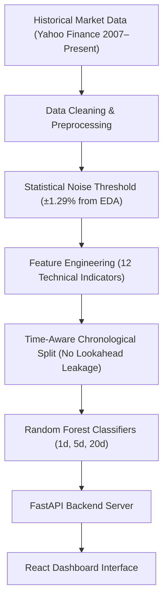

# NIFTY 50 Market Intelligence & Movement Prediction System

A machine learning system that predicts the **probability of statistically significant directional movements** in the NIFTY 50 index across multiple time horizons (**Tomorrow**, **Next 5 Days**, and **Next 1 Month**).

---

## 🌐 Live Demonstration

* **Live Web App:** [https://market-intelligence-theta-six.vercel.app](https://market-intelligence-theta-six.vercel.app)
* **Backend API (FastAPI):** [https://market-intelligence-backend-4xfr.onrender.com](https://market-intelligence-backend-4xfr.onrender.com)
* **API Documentation:** [https://market-intelligence-backend-4xfr.onrender.com/docs](https://market-intelligence-backend-4xfr.onrender.com/docs)

---

## 📌 Project Overview

Most academic stock prediction projects attempt to forecast exact next-day closing prices using regression techniques (e.g., LSTMs or Linear Regression). In financial time series, prices exhibit near-random-walk behavior; regression models typically learn to output yesterday's price with a 1-day lag, achieving deceptively high $R^2$ but offering zero practical decision-making edge.

This project reframes the problem from unconstrained regression to **statistical regime classification**:
1. **Empirical Noise Threshold ($\pm 1.29\%$):** Based on the empirical standard deviation ($1\sigma$) of 19 years of daily returns, price movements within $\pm 1.29\%$ are treated as everyday market noise (~80% of days), while moves beyond that threshold are classified as significant directional moves (~20% of days).
2. **Multi-Horizon Perspective:** Simultaneously generates predictions for **Tomorrow (1-Day)**, **Next 5 Days (Weekly)**, and **Next 1 Month (20-Day)**.
3. **Calibrated Probabilities:** Instead of binary guesses, outputs calibrated probability distributions (e.g., *Expected to Go Up, Staying Steady, Expected to Go Down*).
4. **Explainable AI (XAI):** Identifies the top technical indicators driving each forecast.

---

## 🏗️ System Architecture



---

## 📊 Key Results & Backtest Performance

Evaluated on an out-of-sample chronological test set (2022–2026) using strict time-aware validation:

* **Balanced Accuracy:** **`41.8%`** (substantially outperforming the random 3-class baseline of $33.3\%$).
* **Strategy Win Rate:** **`62.2%`** on active trade days.
* **Risk Reduction:** By remaining in cash during low-conviction/choppy sessions, the strategy demonstrated a **2.6× reduction in daily volatility** compared to Buy-and-Hold with lower peak-to-trough drawdowns.

---

## 🚀 How to Run Locally

### 1. Start the Backend (FastAPI)
```bash
# From project root
pip install fastapi uvicorn pandas numpy scikit-learn ta yfinance joblib
python -m uvicorn backend.src.api:app --reload --host 127.0.0.1 --port 8000
```

### 2. Start the Frontend (React + Vite)
In a second terminal:
```bash
cd frontend
npm install
npm run dev
```
Open **`http://localhost:5173`** in your browser.

---

## 📁 Repository Structure

```
market-intelligence-project/
├── backend/
│   ├── data/
│   │   ├── raw/               # Downloaded historical market data
│   │   └── processed/         # Cleaned data and feature matrices
│   ├── models/                # Serialized trained Random Forest models (.joblib)
│   └── src/
│       ├── fetch_from_yahoo.py   # Automated data collection pipeline
│       ├── clean_data.py         # Data cleaning & validation
│       ├── feature_engineering.py # Technical indicators and label generation
│       ├── train_model.py        # Model training with TimeSeriesSplit
│       ├── backtest.py           # Historical simulation and equity curve
│       └── api.py                # FastAPI REST microservice
├── frontend/
│   ├── src/
│   │   ├── App.jsx            # Main interactive dashboard component
│   │   └── main.jsx           # React entry point
│   ├── package.json           # Frontend dependencies
│   └── tailwind.config.js     # Tailwind CSS theme configuration
├── notebooks/
│   └── 01_eda.ipynb           # Exploratory data analysis & threshold derivation
└── reports/
    └── backtest_chart.png     # Strategy equity curve vs Buy-and-Hold
```

---

## 📄 License & Overview

Built as a high-performance quantitative financial machine learning and statistical time-series classification platform for benchmark index analytics.

